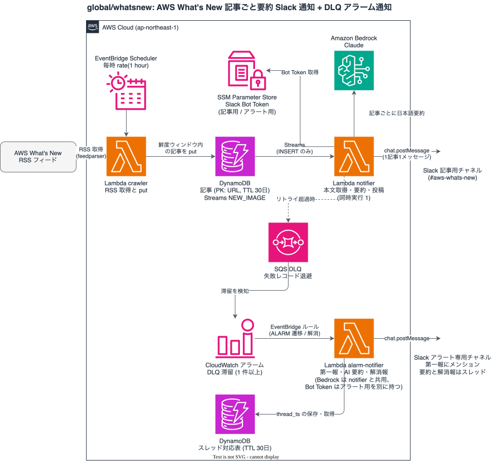

# aws-whats-new-notifier

AWS What's New の新着記事を毎時クロールし、記事ごとに Amazon Bedrock の Claude で日本語要約して
Slack に投稿する。Terraform で 1 つの AWS アカウントにデプロイする。

[aws-samples/whats-new-summary-notifier](https://github.com/aws-samples/whats-new-summary-notifier)
の処理方式を踏襲し、Slack 連携を Bot Token 方式に、失敗時の扱いを DLQ + アラーム通知に変えている。

## 構成



```
EventBridge Scheduler（毎時 rate(1 hour)）
  → crawler Lambda（Python）
      RSS フィードを feedparser で取得し、鮮度ウィンドウ内（既定: 2日）の
      記事を DynamoDB に put（既存 URL の再 put は MODIFY になり再通知されない）
  → DynamoDB（PK: 記事 URL、Streams NEW_IMAGE、TTL 30日、削除保護）
  → DynamoDB Streams（batch size 1 でシャード単位の直列）
  → notifier Lambda（Python。INSERT イベントのみ処理）
      1. 記事ページの本文を取得（<main> 抽出。失敗時は RSS description）
      2. Bedrock の Claude（既定: jp.anthropic.claude-sonnet-4-6）で日本語要約
      3. chat.postMessage で 1 記事 1 メッセージを Slack に投稿
  → リトライ（最大2回）超過の失敗レコードは SQS の DLQ へ退避
  → DLQ の滞留は CloudWatch アラーム（prod-whatsnew-dlq-messages-visible-p3）が検知
  → EventBridge ルール（アラームの ALARM 遷移と ALARM → OK だけを拾う）
  → alarm-notifier Lambda（Python）
      1. アラート専用チャネルに第一報を投稿（AWS Chatbot 風の表示。色の帯 + 項目 + リンク。
         メンション先を設定していれば第一報にだけ付ける）
      2. Bedrock の Claude で日本語訳・要約し、同じスレッドに返信
      3. 解消（ALARM → OK）は ALARM のスレッドに返信（対応表は DynamoDB）
```

- AI に渡すプロンプトは [lambda/prompt.md](lambda/prompt.md)（記事の要約）と
  [lambda/alarm_prompt.md](lambda/alarm_prompt.md)（アラームの要約）で管理する
- 記事は専用チャネルに、専用の Bot で投稿する
- DLQ 滞留アラームは、記事とは別のアラート専用チャネルに、アラート用の別の Bot で投稿する
  （記事用の Token が失効して DLQ に滞留したときも、アラームは通知できるようにするため）
- リソース名は `name_prefix`（既定 `prod-whatsnew`）から決まる。以下の例はすべて既定値の場合

| ファイル | 内容 |
| --- | --- |
| `lambda.tf` | Lambda パッケージのビルド、crawler / notifier、Streams のイベントソースマッピング、DLQ |
| `dynamodb.tf` | 記事履歴のテーブル |
| `scheduler.tf` | 毎時のスケジュール |
| `alarms.tf` / `modules/alarms/sqs_queue` | DLQ 滞留アラーム |
| `alarm_notifier.tf` | アラームの通知（EventBridge ルール、alarm-notifier、スレッド対応表） |
| `lambda/` | Lambda のソースとプロンプト |
| `tests/` | ユニットテスト（pytest） |

## 前提

- Terraform 1.11 以上（S3 ネイティブロック `use_lockfile` を使う）
- Python 3 と pip（Lambda パッケージのビルドとテスト）
- デプロイ先の AWS アカウントの認証情報（管理者相当）
- tfstate を置く S3 バケット（バージョニング有効）
- Slack ワークスペースで App を作成できる権限

## セットアップ

1〜3 は Terraform の外で行う。**欠けたまま apply すると notifier やアラーム通知が失敗する。**
アラーム通知の失敗はログにしか残らないので、apply の前に済ませる。

### 1. 専用チャネルと Slack App の作成

1. 記事用の専用チャネルを作成する（例: `#aws-whats-new`）
2. https://api.slack.com/apps で新規 App を作成する（From scratch）
3. 「OAuth & Permissions」→ Bot Token Scopes に `chat:write` を追加する
4. ワークスペースにインストールし、Bot User OAuth Token（`xoxb-` で始まる）を控える
5. 専用チャネルで `/invite @<Bot名>` を実行して Bot を招待する
6. チャネル名を右クリック → リンクをコピーし、URL 末尾のチャネル ID（`C` で始まる）を控える
7. アラート用に、手順 1〜6 をもう一度行う。アラート専用チャネルを作成し、
   **記事用とは別の Slack App（Bot）** を作成して `chat:write` を付け、インストールして
   Token を控え、アラート専用チャネルに招待して、チャネル ID を控える。
   アラート用 Bot はほかのシステムと共有してよい。作成済みならそれを使い、
   チャネルへの招待と ID の確認だけを行う
   （**招待を忘れるとアラーム通知が `not_in_channel` で失敗し、ログにしか残らない**）

### 2. Bot Token を SSM に登録

Token は Terraform 管理外（tfvars / state に残さない）。デプロイ先アカウントの認証情報で、
手元の端末から1回だけ実行する。

```bash
# デプロイ先のアカウントに繋がっているか必ず確認する
aws sts get-caller-identity --query 'Arn' --output text
```

Token がシェル履歴に残らないよう、`read -s` で入力してから登録する。

```bash
read -s SLACK_BOT_TOKEN   # xoxb- で始まる Token を貼り付けて Enter
aws ssm put-parameter \
  --name /whatsnew/slack-bot-token \
  --type SecureString \
  --value "$SLACK_BOT_TOKEN" \
  --region ap-northeast-1
unset SLACK_BOT_TOKEN
```

アラート用 Bot の Token も同じ手順で登録する。ほかのシステムと共有できるよう、パラメータ名は
共有のパス `/alerts/slack-bot-token` にしてある（登録済みならこの手順は不要）。

```bash
read -s SLACK_BOT_TOKEN   # アラート用 Bot の Token（xoxb-）を貼り付けて Enter
aws ssm put-parameter \
  --name /alerts/slack-bot-token \
  --type SecureString \
  --value "$SLACK_BOT_TOKEN" \
  --region ap-northeast-1
unset SLACK_BOT_TOKEN
```

**アラート用の Token を登録し忘れると、alarm-notifier は Token を取得できずに失敗し、
Slack にも通知できない（ログにしか残らない）。** apply の前に必ず登録する。

- パラメータ名は変数 `slack_bot_token_parameter` / `alarm_slack_bot_token_parameter` で変えられる
- Token をローテーションする場合は `--overwrite` を付けて再実行する

### 3. Bedrock のモデル利用可否確認

既定のモデルは `jp.anthropic.claude-sonnet-4-6`。次の呼び出しが応答を返せば使える。

```bash
aws bedrock-runtime converse --region ap-northeast-1 \
  --model-id jp.anthropic.claude-sonnet-4-6 \
  --messages '[{"role":"user","content":[{"text":"reply OK only"}]}]' \
  --inference-config '{"maxTokens":10}'
```

- **プレイグラウンドでモデルを選択できることは、呼び出せることの証明にならない。**
  確認は必ず実際の呼び出しで行う
- 作成直後のアカウントは Bedrock の実行クォータが 0 のことがある。その場合はサポートケースで
  引き上げを依頼する
- requests per minute のクォータが小さい場合、新着が集中すると要約が欠ける可能性がある
  （その記事は要約なしで投稿される）。notifier は batch size 1 の直列処理なので、通常は小さくても足りる

### 4. backend と tfvars の設定

```bash
cp backend.tf.example backend.tf
cp terraform.tfvars.example terraform.tfvars
```

- `backend.tf` の `bucket` を tfstate 保管用のバケット名に書き換える
- `terraform.tfvars`
  - `owner`: 全リソースに付ける Owner タグの値
  - `slack_channel_id`: 手順 1-6 で控えたチャネル ID
  - `alarm_slack_channel_id`: 手順 1-7 で控えたアラート専用チャネルの ID
  - `slack_mention_user_id`: アラームの第一報でメンションするユーザーのメンバー ID
    （`U` で始まる）。空文字ならメンションしない
- 初回 apply 直後は鮮度ウィンドウ分の過去記事がまとめて投稿される。
  量を抑えるため、初回は `freshness_window_days = 1` で apply し、稼働を確認してから既定値（2）に戻す
- アラームの優先度は `alarms.tf` の `priority` で決める（アラーム名の末尾に入る）
- そのほかの変数（モデル ID、フィード URL、リソース名のプレフィックスなど）は
  [variables.tf](variables.tf) を参照

どちらのファイルも `.gitignore` 済みで、コミットされない。

### 5. デプロイ

```bash
terraform init
terraform plan
terraform apply
```

Lambda パッケージは apply 時に `scripts/build.sh` が自動でビルドする。
依存（feedparser / sgmllib3k / beautifulsoup4 / soupsieve）はすべて純 Python のため、
ビルド環境の OS / アーキテクチャに依存しない。なお sgmllib3k は wheel が公開されて
いない（sdist のみ）ため、wheel 限定の取得方式は使えない
（詳細は `scripts/build.sh` のコメントを参照）。

## 疎通テスト

毎時の定期実行があるため、apply 後は放置しても最大1時間で自然に動き出す。
即時に確認したい場合は crawler を手動実行する（実行の度に新着があれば Slack へ投稿される）。

```bash
# 1. crawler を手動実行する（出力: {"total": フィード内の記事数, "put": put した件数}）
aws lambda invoke --region ap-northeast-1 \
  --function-name prod-whatsnew-crawler --payload '{}' /tmp/crawler-out.json
cat /tmp/crawler-out.json

# 2. notifier の処理結果を確認する（各起動の "records: N, notified: M" とエラー有無）
aws logs filter-log-events --region ap-northeast-1 \
  --log-group-name /aws/lambda/prod-whatsnew-notifier \
  --filter-pattern '"notified"' --query 'events[].message' --output text

# 3. DynamoDB に記事が入っていることを確認する
aws dynamodb scan --region ap-northeast-1 \
  --table-name "$(terraform output -raw table_name)" --select COUNT

# 4. DLQ が空であることを確認する
aws sqs get-queue-attributes --region ap-northeast-1 \
  --queue-url "$(terraform output -raw dlq_url)" \
  --attribute-names ApproximateNumberOfMessages
```

確認ポイント:

- 記事用のチャネルに記事ごとの要約メッセージが投稿されている
- **crawler をもう一度実行しても既存記事は再通知されない**
  （既存 URL の put は MODIFY イベントになり、notifier のログに
  `records: 1, notified: 0` と出て Slack には何も投稿されない）
- DLQ が 0 件（滞留がある場合は「運用メモ」を参照）

### DLQ 滞留アラームの通知

まずサンプルイベントで alarm-notifier を直接実行して、投稿の内容を確認する。
この方法では EventBridge ルールの発火までは確かめられない。ルール経由の経路まで確かめるには、
DLQ に実際にメッセージを入れて、アラームの遷移から通知が出るところまで一度通す
（ALARM まで最大 5 分かかる。確認後は DLQ を空に戻す）。

```bash
# 1. ALARM 遷移のサンプルイベントで実行する（account は自分のアカウント ID に置き換える）
cat > /tmp/alarm-event.json <<'JSON'
{
  "source": "aws.cloudwatch",
  "detail-type": "CloudWatch Alarm State Change",
  "account": "123456789012",
  "region": "ap-northeast-1",
  "time": "2026-01-01T00:00:00Z",
  "detail": {
    "alarmName": "prod-whatsnew-dlq-messages-visible-p3",
    "state": {"value": "ALARM", "reason": "疎通テスト: Threshold Crossed"},
    "previousState": {"value": "OK"},
    "configuration": {
      "description": "prod-whatsnew-dlq にメッセージが滞留しています",
      "metrics": [{"metricStat": {"metric": {
        "namespace": "AWS/SQS", "name": "ApproximateNumberOfMessagesVisible",
        "dimensions": {"QueueName": "prod-whatsnew-dlq"}}, "period": 300, "stat": "Maximum"}}]}
  }
}
JSON
aws lambda invoke --region ap-northeast-1 --cli-binary-format raw-in-base64-out \
  --function-name prod-whatsnew-alarm-notifier --payload file:///tmp/alarm-event.json /tmp/alarm-out.json
cat /tmp/alarm-out.json

# 2. 解消（ALARM → OK）のサンプルイベントで実行する
sed -e 's/"value": "ALARM", "reason": "疎通テスト: Threshold Crossed"/"value": "OK", "reason": "疎通テスト: 解消"/' \
    -e 's/"previousState": {"value": "OK"}/"previousState": {"value": "ALARM"}/' \
    /tmp/alarm-event.json > /tmp/alarm-ok-event.json
aws lambda invoke --region ap-northeast-1 --cli-binary-format raw-in-base64-out \
  --function-name prod-whatsnew-alarm-notifier --payload file:///tmp/alarm-ok-event.json /tmp/alarm-out.json
cat /tmp/alarm-out.json
```

確認ポイント:

- アラート専用チャネルに第一報が投稿されている（記事のチャネルには出ない）。赤い帯の中に
  アラーム名・状態・メトリクスなどの項目と、コンソールへのリンクが並ぶ。
  帯の上には何も出ない。`slack_mention_user_id` を設定している場合だけ、帯の上に
  メンションだけの行が出る
- 第一報のスレッドに AI 要約が返信されている
- 解消のイベントが、緑の帯で第一報と同じスレッドに返信されている（メンションは付かない。
  アラームの説明文も出さない）
- 第一報の「Account」がイベントに書いたアカウント ID になっている

## テスト

boto3 に依存しない部分（フィードのパース、鮮度判定、プロンプト構築、Slack のペイロードなど）を
pytest で検証する。AWS には繋がない。

```bash
python3 -m pip install pytest -r lambda/requirements.txt
python3 -m pytest tests/
```

## 運用メモ

- **新着が無い時間帯は何も投稿されない**（crawler が put しなければ notifier は起動しない）。
  「通知が来ない = 故障」ではない点に注意。動作確認はログで行う
- **DLQ 滞留の通知は OK→ALARM の遷移時に1回だけ。** ALARM 継続中に追加のメッセージが入っても
  再通知されない。通知が来たら下の「DLQ の再処理」で対応し、DLQ が空に戻ったことを確認する
  （空に戻るとアラームが OK になり、解消の通知が同じスレッドに返信される）
- **DLQ の再処理**: メッセージ本文は失敗した Streams レコードのメタデータ。
  内容を確認し、再通知したい場合は DynamoDB から該当 URL の item を削除して
  crawler を再実行する（鮮度ウィンドウ内なら再 put = INSERT となり再通知される。
  ウィンドウ外の記事は put されないため、手動で put する）
- **alarm-notifier 自身の失敗**: ログ（`/aws/lambda/prod-whatsnew-alarm-notifier`）に出力し、
  失敗した旨をアラート専用チャネルにも投稿する（第一報が投稿済みならそのスレッド）。
  リトライはしない（第一報の重複防止）。**Slack への投稿そのものが失敗する障害
  （Token の失効・Bot の未招待・Slack 側の障害）は Slack では知らせられず、ログにしか残らない**
- **クロールの一時停止**: `terraform.tfvars` に `schedule_state = "DISABLED"` を書いて apply すると、
  毎時のスケジュールが止まる（再開は行を消すか `ENABLED` に戻す）。鮮度ウィンドウ（既定 2 日）より
  長く止めると、その間の記事は再開しても通知されない

## 片付け

記事履歴のテーブル（`prod-whatsnew-rss-history`）は削除保護を有効にしているため、
そのままでは `terraform destroy` が失敗する。

1. `dynamodb.tf` の `deletion_protection_enabled` を `false` にして `terraform apply` する
2. `terraform destroy` を実行する

Terraform の外で作ったものは残るので、不要なら手動で消す。

- SSM パラメータ（`/whatsnew/slack-bot-token` と `/alerts/slack-bot-token`）。
  アラート用をほかのシステムと共有している場合は消さない
- Slack の App とチャネル
- tfstate 保管用のバケットに残る state ファイル

## ライセンス

[MIT](LICENSE)
